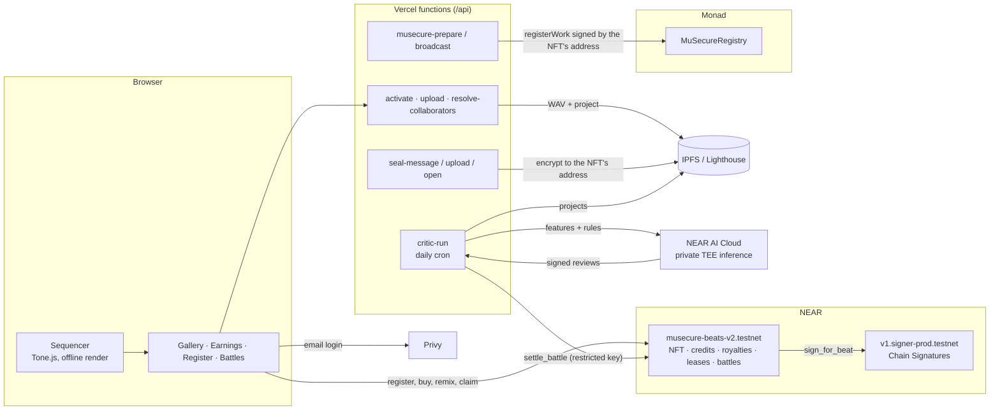

# MuSecure Beats

**Make a beat in your browser. Mint it as an NFT that owns money, earns cascading royalties, holds its own account on another chain, and keeps its source sealed — and when the NFT is sold, all of that moves to the buyer. Then remix the weekly seed and let an AI critic on NEAR AI decide who takes the prize.**

Built for the NEAR Hackathon (Nov 2026) · Tracks: **NFTs That Do Something** · **Games** · **Open**
Part of the [MuSecure](https://github.com/Fsk8/MuSecure-Core-Functions) ecosystem (music authorship on Monad), by Favio & Ingrid — Cochabamba, Bolivia.

- **Live app:** https://musecure-beats.vercel.app
- **Contract (NEAR testnet):** [`musecure-beats-v2.testnet`](https://testnet.nearblocks.io/address/musecure-beats-v2.testnet)
- **Demo video:** _TODO_

---

## Why this fits "NFTs That Do Something"

> "Build NFTs as accounts — assets that own money, earn royalties, hold inventory, carry credentials, memberships or access rights. Ownership with behavior."

| The track asks for… | What a MuSecure Beats NFT does |
|---|---|
| **Owns money** | Every NFT keeps its own *authors' balance* inside the contract. Anyone can trigger `claim`, and the money always goes to the credited authors — never to the caller. |
| **Earns royalties** | 50 % of every income goes to the current owner, 50 % to the authors. Remixes send 20 % of their authors' share **up to the original, in cascade** across the whole remix tree. 10 % of every resale goes to the authors (also exposed as NEP-199 payouts for external marketplaces). |
| **Holds inventory / is an account** | Each NFT has **its own EVM address**, derived by NEAR's MPC network from the contract and the path `beat-<id>` (**Chain Signatures**). Only the current NFT owner can make it sign (`sign_for_beat`). We use it to certify the beat on MuSecure (Monad) — the certificate belongs to the NFT, not to a person. |
| **Carries credentials / access rights** | Non-exclusive licenses are on-chain credentials (`has_lease`), verifiable by anyone (a distributor, a label, a platform). Licensees get stems (WAV), MIDI and a license certificate. |
| **Access rights that travel** | A **sealed project** is encrypted (Lighthouse) to the NFT's own address. Only the current owner can obtain the key. **Sell the NFT and the buyer can open it; the seller can't.** |
| **Dynamic NFTs** | The cover is an SVG **generated on chain** from the beat's notes, with a level (1–10) and badges that evolve: Original/Remix, Remixed, Seed, Licensed, Popular, Earns royalties, 1 NEAR earned, Exclusive sold, Collaborative, Battle winner. Standard NEP-177 metadata, so any wallet or explorer sees it up to date. |
| **History per NFT** | Every holder, the price they paid and what they earned as owner; what the NFT earned and paid to its authors (`get_beat_history`). See *Transfer & threat model*. |
| **NEP-171** | Full NEP-171/177/178/181 implementation (`near-contract-standards` 5.29.1) plus NEP-199 payouts. |

## Transfer & threat model: what moves with the NFT, and why the seller can't keep it

Each beat NFT controls **its own account**: an EVM address that NEAR's MPC network derives from this contract and the path `beat-<id>` (Chain Signatures). The contract only asks the MPC network to sign for that address when the caller is the **current owner** (`sign_for_beat`). There is no key to hand over: control is "whoever `nft_token(id).owner_id` is right now", checked on every call.

**What moves to the buyer on transfer** (`buy`, `nft_transfer`, `nft_transfer_call`, `nft_transfer_payout`): the right to sign as the beat's account (and with it its Monad balance and MuSecure certificate), the key to the sealed project, all future owner income, and price controls. **What doesn't move, by design:** owner income earned *before* the sale (already credited to the seller's account), the authors' balance and credits (they belong to the authors, like publishing), and non-exclusive licenses already sold.

| # | How a seller could try to keep money or access | What stops it | Test |
|---|---|---|---|
| 1 | Keep earning after the sale | Income is split at the moment it arrives, using the current owner (`credit_income`). Calls to one contract run one at a time, so income lands either before or after the sale, never half-way. | `income_before_the_sale_stays_with_the_seller_after_it_goes_to_the_buyer` |
| 2 | Take the authors' balance with the sale | It isn't the owner's: `claim` always pays the credited authors (and 20 % to the original), whoever holds the NFT. | `a_sale_in_the_middle_of_a_payout_does_not_change_who_gets_paid`, `a_payout_right_before_the_sale_is_also_safe` |
| 3 | Re-list it or sell it again through an old marketplace approval | The sale clears the listing (`on_owner_change`) and the NEP-171 transfer clears every approval. | `the_sale_clears_listing_and_marketplace_approvals`, `the_seller_cannot_relist_after_the_sale` |
| 4 | Sign with the beat's account after selling | `sign_for_beat` checks the current owner on every call. | `the_seller_cannot_sign_with_the_beat_account_after_the_sale` |
| 5 | Ask for a signature right before selling, so it arrives after the buyer owns it (the MPC answer is asynchronous) | The account **cannot sign while the NFT is listed**, and the NFT **cannot be listed or sold within 10 minutes of a signature** (`SIGN_SETTLE_MS`). | `the_beat_account_cannot_sign_while_listed`, `a_fresh_signature_blocks_listing`, `listing_is_allowed_once_signatures_settle` |
| 6 | Pre-sign an EVM transaction from the beat's account and broadcast it after the sale | Every signature the account ever produced is logged on chain (`sign_for_beat` events, with the payload) and counted in the NFT's history, so a buyer can audit it before buying. After buying, the new owner can send one transaction from the account to use up its next nonce, which invalidates anything pre-signed. *(Limit: this needs the buyer to act; it isn't enforced by the contract.)* | history view |
| 7 | Keep opening the sealed project | Every opening needs a fresh signature from the beat's account, which only the current owner can request. *(Limit: a copy the seller decrypted before selling can't be taken back.)* | `owner_seals_project_and_remixes_close`, sealing flow |
| 8 | Undercut the buyer by selling new licenses | A transfer closes new non-exclusive licenses for good (`exclusive_sold`); nobody can reopen them. | `the_buyer_cannot_be_undercut_with_new_licenses_by_the_seller` |

**History per NFT** (`get_beat_history`, and *Gallery → Details → History*): every holder with the date and the price they paid, what each one earned as owner, the total earned, what was paid to the authors and what is still waiting, and how many times the beat's account signed. Beats registered before v5 start their history with their creator and current owner.

**Why not a NEAR sub-account per NFT?** A sub-account (`beat-4.musecure-beats-v2.testnet`) would have to change hands by rotating its full-access keys, which a seller could front-run or keep a copy of. A Chain Signatures account has no key at all: control follows the NFT owner by construction, and it works on any EVM chain. (We do use a NEAR sub-account where it fits: the critic, `critic.musecure-beats-v2.testnet`, holds only a function-call key.)

## Remix Battles + The Critic (Games)

Every week there is a **seed beat**. Players remix it in the browser; every open remix of the seed registered inside the battle window is an entry. Anyone can add NEAR to the prize pool.

When the battle closes, **The Critic** — an NPC agent running on **NEAR AI Cloud** (private TEE inference) — reads every entry's project, computes musical features (key, tempo, density, syncopation, how much of the seed it kept and which tracks it changed) and writes a score and a review for each one. NEAR AI signs the model's response; the reviews, the exact request and response, and that signature are published on IPFS so anyone can check them.

The Critic then calls `settle_battle` with a **function-call key that can only call that method** — it can rank entries, it can't move money anywhere. The contract checks that every entry was scored, ranks them and pays **50 / 30 / 20 %** of the pool as **income of the winning NFTs**: half to their owners, half to their authors, and 20 % of the authors' part flows up to the seed. The winner earns the **Battle winner** badge and +2 levels on its on-chain cover.

The economy is the gameplay: a good seed earns from every remix and every prize its remixes win.

**Why it's an NPC, not a script.** The Critic has a persona ("demanding but fair"), judges against the week's rules, and writes reviews tied to the numbers — e.g. *"You nailed the rule by keeping the bassline intact while gutting the drums down to a mere 6 % retention, then slapped on a 105 BPM tempo and 7 % swing to reshape the pocket."* Its judgement moves real money.

**Verify a battle yourself.** Each battle's `review_cid` (on chain, `get_battle`) points to a JSON with every review, the exact request sent to the model, the raw response, and NEAR AI's signature. The signed text is `<model>:<sha256(request)>:<sha256(response)>`; recover the signer with EIP-191 and check it against the TEE attestation report at `https://cloud-api.near.ai/v1/attestation/report?model=<model>&signing_algo=ecdsa`.

| Battle rule | Enforced by |
|---|---|
| Only open (not sealed) remixes of the seed, registered inside the window, are entries | contract (`get_battle_entries`) |
| Every entry must be scored, 0–100, no outsiders, no duplicates | contract (`settle_battle`) |
| Only the critic can settle, only after the deadline, only once | contract |
| Prize split 50 / 30 / 20 % (normalized if fewer entries; back to the admin if none) | contract |
| Funding closes at the deadline | contract (`fund_battle`) |
| The critic can't take funds | NEAR access key restricted to `settle_battle`, 0 deposit |

## Try it in 5 minutes ("do X, see Y")

1. **Open the app and press ▶ Play.** You hear the example beat. Click cells, change **Scale**, try **Surprise me (all)** — every pattern follows the chosen key.
2. **Sign in with email.** Privy creates a NEAR account for you; the server sponsors 0.05 testnet NEAR to activate it. No wallet, no seed phrase.
3. **Register on NEAR.** Name the beat, optionally credit a collaborator **by email** (they get a NEAR account tied to that email, even if they never signed in), pick **Open** or **Sealed**, set remix and license prices, and press **Register beat**. The WAV is rendered offline and uploaded to IPFS; its SHA-256 and the MuSecure audio fingerprint are stored on chain.
4. **Gallery → your beat.** You see the **cover generated by the contract** with your notes, "Lv 1" and the badge "Original". Press **Verify audio**: the app downloads the WAV from IPFS and checks it against the on-chain hash.
5. **Details → MuSecure (Monad) → Register on MuSecure from the NFT account.** One NEAR transaction; NEAR's MPC network signs a Monad transaction **as the NFT**. The beat appears as a MuSecure certificate owned by the NFT's address.
6. **From a second account:** buy a non-exclusive license (badge "Licensed" appears), download the **stems** and the **license certificate**, or **Remix** the beat — the app shows how much of the original you kept (≥ 30 % → it's a remix and pays the remix license).
7. **Owner controls → List for sale. Second account → Buy NFT.** The authors get 10 %; the buyer now controls the NFT's Monad account and can **open the sealed project**, while the seller no longer can.
8. **My earnings.** Owner earnings to withdraw, the money sitting inside each NFT, and one-click **Distribute** to the authors.
9. **Battles.** Open the current battle: listen to the seed, read the rules, press **Remix the seed**, change it and register it as **Open** before the deadline — it enters automatically. Add NEAR to the prize if you like. After the deadline The Critic judges: the battle shows the ranking, every review, the prizes and the link to the signed proof. The winner's cover gets the **Battle winner** badge.

## Live proof (testnet)

| Step | Transaction |
|---|---|
| Register a beat | _TODO_ |
| `sign_for_beat` → MuSecure certificate on Monad | NEAR: _TODO_ · Monad: _TODO_ |
| Seal a project (`set_sealed_project`) | _TODO_ |
| Buy a non-exclusive license | _TODO_ |
| Remix (pays the original) | _TODO_ |
| Sell the NFT (`buy`) | _TODO_ |
| History of an NFT (`get_beat_history`) | _TODO_ (view call) |
| Distribute authors' balance (`claim`) | _TODO_ |
| The Critic settles a Remix Battle (`settle_battle`, NEAR AI reviews + TEE signature) | [488sN4h6…](https://testnet.nearblocks.io/txns/488sN4h69ePHpVH44rDw7CWhyYQ1u5n5teuCDFKsjqN5) · [reviews & proof](https://gateway.lighthouse.storage/ipfs/bafkreiganvfv35omrxjx6ws34j6lfng5n24hesa36skzb7tfuwwupkrl24) |

## Proof bundle: what each beat NFT proves

Short musical pieces collide: a 16-step drum pattern or a I–V–vi–IV progression is not original, and an audio fingerprint alone is easy to dodge and weak in a dispute. So MuSecure Beats doesn't try to "prove originality". Every registered beat carries a **proof bundle** on chain instead:

| Proof | What it shows | Where |
|---|---|---|
| SHA-256 of the project file | This exact composition (notes, sounds, mix) existed and was registered by this account | `project_hash` |
| SHA-256 of the rendered audio | The exact recording (the master) | `audio_hash` |
| MuSecure audio fingerprint | Identifies the same audio across MuSecure Beats and MuSecure (Monad) | `musecure_fingerprint`, `get_beats_by_fingerprint` |
| Author, credits and block timestamp | Who, with whom, and since when | `creator`, `credits`, `created_at_ms` |
| Declared lineage | Which beat it was remixed from — and the royalty that follows | `parent_id`, `remix` |

**Similarity informs attribution; it doesn't judge originality.** When a new beat matches an existing one exactly, the app warns and suggests registering it as a remix, so the money follows the lineage. Melodic tracks weigh more than drums, and generic patterns never trigger anything. Next: a symbolic melodic fingerprint (intervals and relative rhythm per track) that also recognises transposed or shifted melodies.

## How the money flows

Each beat has two separate rights, as in the music industry:

- **Authors** (like *publishing*): the creator and the credited collaborators. **Never change.** If credits add up to less than 100 %, the rest belongs to the creator.
- **Owner** (like the *master*): whoever holds the NFT. Changes when the NFT is sold.

| Income | Split |
|---|---|
| Non-exclusive license, remix license, support | **50 %** to the current owner (withdraw) · **50 %** stays inside the NFT as the authors' balance (distribute) |
| A remix's authors' balance | **20 %** goes up to the original beat as income (split 50/50 again there) · 80 % to the remix's authors |
| NFT sale | **90 %** to the seller · **10 %** to the authors' balance |

Selling the NFT moves future owner earnings, price controls, the NFT's Monad account and the sealed-project key to the buyer. Credits never move. New non-exclusive licenses close (the exclusive changed hands); existing ones stay valid.

## Architecture



- **Frontend:** React 18 + Vite 5, Tone.js 14. Drums are pre-rendered into samples for performance; exported WAVs are rendered offline (no glitches, full quality).
- **Accounts:** Privy email login with NEAR embedded wallets (`@privy-io/react-auth` extended chains). New accounts are activated by a sponsor account; collaborators credited by email get pre-generated NEAR wallets.
- **Contract:** Rust, `near-sdk` 5.29.1, 68 unit tests. Upgrades keep state (`migrate`).
- **Storage:** WAV and project on IPFS (Lighthouse), SHA-256 hashes on chain. The Lighthouse key never reaches the browser.
- **MuSecure bridge:** metadata in MuSecure's format, MuSecure's treasury funds the NFT's Monad address, MuSecure's backend signs the score (partner key), and NEAR's MPC network signs `registerWork` for the NFT.
- **The Critic:** a Vercel function on a daily cron. It reads each entry's project from IPFS, computes features, calls NEAR AI Cloud's OpenAI-compatible API (`Qwen/Qwen3.6-35B-A3B-FP8`, private TEE), fetches the response signature, uploads everything to IPFS and settles on chain. About 4,500 tokens per battle (< $0.01). Without a NEAR AI key a deterministic test critic scores, so the game runs end to end in development.
- **Audio fingerprint:** the same algorithm as MuSecure (ported unchanged), so the same audio produces the same fingerprint in both apps.

## Honest limits (and next steps)

- **Trusted server pieces.** Account activation, credits by email and the MuSecure bridge run in Vercel functions with server-side keys. Sealing: the server verifies the NFT's signature and handles the project in memory while encrypting/decrypting, but stores no keys — without a fresh signature from the NFT owner it cannot decrypt.
- **Open projects are public.** For open beats, anyone could rebuild the stems from the public project; the license is the verifiable *right* to use them. Sealed beats protect the project but turn off remixes.
- **Licensees can't open sealed projects automatically.** Lighthouse access conditions don't support NEAR yet; the next step is a NEAR-aware condition (or sharing per license, signed by the NFT).
- **Exact copies are caught, near-copies aren't yet** (see *Proof bundle*). Every beat's MuSecure audio fingerprint is indexed on chain (`get_beats_by_fingerprint`); the app warns before registering an identical beat, and MuSecure on Monad refuses to certify a duplicate fingerprint. The 30 % remix similarity check runs in the app, so a lightly edited copy can still be registered as original; a signed similarity oracle is the next step.
- **The Critic can't hear.** It judges features computed from the sequencer project, not the audio. LLM scoring isn't deterministic: re-judging can shift scores; the official result is the one settled on chain and published on IPFS. The critic server is trusted to run the model honestly — the TEE signature proves which model produced the reviews, and the contract limits what the critic can do with them.
- **Battles are created by the admin.** Anyone can fund and enter; opening battle creation to everyone needs a deposit and anti-spam rules.
- **Score 0 on MuSecure.** Beats registered from the sequencer skip MuSecure's catalog analysis; their metadata says so ("Catalog analysis: No").
- **DAW plugin.** Beats export as MIDI (one track per instrument, General MIDI drums) for any DAW today; a VST3/AU/CLAP plugin that opens beats and licenses from NEAR is the next step.
- **Testnet only.** Not audited.

## Roadmap

1. **DAW compatibility (main goal).** Producers live in their DAW, so MuSecure Beats should meet them there. Today: MIDI export (one track per instrument) and WAV stems for any DAW. Next: a lightweight plugin (VST3 / AU / CLAP) that registers and certifies what you make in the DAW and checks licenses, while signing stays in the browser so the plugin never holds keys.
2. **Better sounds in the web app.** Every sound is synthesized in the browser today, which keeps the app light but limits the quality. The plan is to add high-quality sampled instruments — including our own recordings of Andean instruments — loaded on demand, plus a better mix chain, for a richer experience both when composing and when playing Remix Battles, while keeping a light mode for older computers.
3. **The Monk that listens.** Judge the rendered audio, not only the project: tempo, space, dynamics and brightness measured from the WAV, plus sound-based similarity to the seed.
4. **Near-copy detection.** A symbolic melodic fingerprint (intervals and relative rhythm per track) that recognises transposed or shifted melodies and suggests attribution.
5. **Mainnet.** After an audit, with real prizes and royalties.

## Hackathon disclosure

Per the NEAR HACKATHON rules (Q-001 to Q-005).

**Built during the hackathon window** (from the announcement on 2026-10-19 to 2026-11-14), in this repository:
- The MuSecure Beats web app: sequencer, gallery, registration, earnings, royalty tree, Remix Battles UI, The Monk and the tutorial.
- The NEAR contract `contracts/beats` (NFT, credits, royalties, licenses, sales, dynamic cover, Chain Signatures account per NFT, sealed projects, battles) and its tests.
- The Vercel functions in `api/` (account activation, IPFS upload, collaborators by email, MuSecure bridge, sealing, the critic on NEAR AI Cloud).

This repository was created on **2026-10-24**, inside the window: all of its code is hackathon work. The submitted state is tagged `hackathon-submission`.

**Pre-existing work (baseline, not judged):**
- **MuSecure** on Monad testnet — the authorship registry, credits and licensing contracts and its backend — built by the same team before the hackathon ([repo](https://github.com/Fsk8/MuSecure-Core-Functions)). MuSecure Beats talks to it as an external service. The only changes made to MuSecure during the window were to support this bridge (its signing and gas APIs now accept a Privy session or a partner key).
- **Audio fingerprint** in `src/fingerprint/`: ported unchanged from MuSecure, so both apps produce the same fingerprint for the same audio.

**Third-party libraries:** `near-sdk` and `near-contract-standards` 5.29.1 (contract); React 18, Vite 5, Tone.js 14, `@near-js/*` 2.x, Privy (`@privy-io/react-auth`, `@privy-io/node`), viem 2, `@lighthouse-web3/sdk`, FFmpeg.wasm (`@ffmpeg/*`), `@noble/hashes`, `jose`. Services: NEAR testnet and Chain Signatures (`v1.signer-prod.testnet`), NEAR AI Cloud, Lighthouse/IPFS, Privy, Vercel.

**AI assistance:** much of the code, tests and documentation was written with an AI coding assistant (Claude), directed and reviewed by the team.

**Hints we lean on:** *NFTs* — dynamic NFTs, NEP-171, a sub-account for the critic. *Games* — agent NPC (The Monk), social login (email via Privy, no wallet), a player economy that runs without dev patches. *Open* — chain abstraction through Chain Signatures.

## Run it locally

```bash
pnpm install
cp .env.example .env.local   # fill in the values (see the comments in the file)
pnpm dev                     # http://localhost:5173
```

Without `VITE_PRIVY_APP_ID` the app runs read-only: you can make music and browse registered beats.

**Tests:** `pnpm test` (JS: music logic, MIDI export, critic features) · `pnpm test:contract` (Rust, 68 tests). Agents and reviewers: see [AGENTS.md](AGENTS.md) for a code map and where each claim lives.

**Contract:** see [contracts/beats/README.md](contracts/beats/README.md) (build with `cargo near build non-reproducible-wasm`, tests with `cargo test`).

### Environment variables

| Variable | Where | Purpose |
|---|---|---|
| `VITE_PRIVY_APP_ID` | browser + server | Privy app (shared with MuSecure) |
| `VITE_NEAR_CONTRACT` | browser + server | Beats contract account |
| `PRIVY_JWKS_URL` (or `PRIVY_VERIFICATION_KEY`) | server | Verify Privy sessions |
| `PRIVY_APP_SECRET` | server | Pre-generate NEAR wallets for collaborators by email |
| `LIGHTHOUSE_API_KEY` | server | IPFS uploads and sealed projects |
| `NEAR_SPONSOR_ACCOUNT_ID`, `NEAR_SPONSOR_PRIVATE_KEY` | server | Activate new accounts |
| `MUSECURE_API_URL`, `PARTNER_API_KEY` | server | MuSecure bridge (gas + score signature) |
| `CRON_SECRET` | server | Protects `/api/critic-run` (Vercel cron + manual trigger) |
| `CRITIC_ACCOUNT_ID`, `CRITIC_PRIVATE_KEY` | server | The critic's account and its key restricted to `settle_battle` |
| `NEARAI_API_KEY`, `NEARAI_MODEL` | server | NEAR AI Cloud (without a key, a deterministic test critic scores) |

## Project structure

```
src/
  audio/          engine.js (Tone.js, offline render, drum samples), presets.js (40 sounds)
  music/          theory.js (scales, chords), patterns.js (state, generators, similarity, art)
  components/     Transport, SoundPanel, Mixer, TrackEditor, Gallery, Earnings, Battles, RegisterPanel, Drawer…
  near/           Privy + NEAR: signer, contract calls, MuSecure bridge, sealing, certificate
  fingerprint/    MuSecure audio fingerprint (FFmpeg in a Web Worker)
api/              Vercel functions: activate, upload, resolve-collaborators, musecure-*, seal-*, critic-run (+ _lib/critic.js)
contracts/beats/  NEAR contract (Rust): NFT, credits, royalties, leases, dynamic cover, sign_for_beat, sealing, battles (battles.rs)
```

## Credits

Favio (music, product, build) and Ingrid (MuSecure co-creator). `src/fingerprint/` is ported from MuSecure (`src/workers/audioFingerprint.worker.ts`). Every sound is synthesized in the browser — no third-party samples.

## License

MIT — see [LICENSE](LICENSE).
