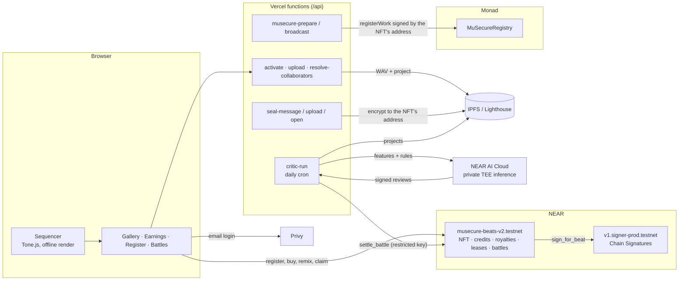

# MuSecure Beats

**Make a beat in your browser. Mint it as an NFT that owns money, earns cascading royalties, holds its own account on another chain, and keeps its source sealed — and when the NFT is sold, all of that moves to the buyer. Then remix the weekly seed and let an AI critic on NEAR AI decide who takes the prize.**

Built for the NEAR Hackathon (Nov 2026) · Tracks: **NFTs That Do Something** · **Games** · **Open**
Part of the [MuSecure](https://github.com/Fsk8/MuSecure-Core-Functions) ecosystem (music authorship on Monad), by Favio & Ingrid — Cochabamba, Bolivia.

- **Live app:** https://musecure-beats.vercel.app
- **Contract (NEAR testnet):** [`musecure-beats-v2.testnet`](https://testnet.nearblocks.io/address/musecure-beats-v2.testnet)
- **Demo video:** _TODO_

---

## Why this fits "NFTs That Do Something"

> "Build NFTs as accounts — assets that own money, earn royalties, hold inventory, carry credentials, memberships or access rights. Ownership with behavior."

| The track asks for… | What a MuSecure Beats NFT does |
|---|---|
| **Owns money** | Every NFT keeps its own *authors' balance* inside the contract. Anyone can trigger `claim`, and the money always goes to the credited authors — never to the caller. |
| **Earns royalties** | 50 % of every income goes to the current owner, 50 % to the authors. Remixes send 20 % of their authors' share **up to the original, in cascade** across the whole remix tree. 10 % of every resale goes to the authors (also exposed as NEP-199 payouts for external marketplaces). |
| **Holds inventory / is an account** | Each NFT has **its own EVM address**, derived by NEAR's MPC network from the contract and the path `beat-<id>` (**Chain Signatures**). Only the current NFT owner can make it sign (`sign_for_beat`). We use it to certify the beat on MuSecure (Monad) — the certificate belongs to the NFT, not to a person. |
| **Carries credentials / access rights** | Non-exclusive licenses are on-chain credentials (`has_lease`), verifiable by anyone (a distributor, a label, a platform). Licensees get stems and a license certificate. |
| **Access rights that travel** | A **sealed project** is encrypted (Lighthouse) to the NFT's own address. Only the current owner can obtain the key. **Sell the NFT and the buyer can open it; the seller can't.** |
| **Dynamic NFTs** | The cover is an SVG **generated on chain** from the beat's notes, with a level (1–10) and badges that evolve: Original/Remix, Remixed, Seed, Licensed, Popular, Earns royalties, 1 NEAR earned, Exclusive sold, Collaborative, Battle winner. Standard NEP-177 metadata, so any wallet or explorer sees it up to date. |
| **NEP-171** | Full NEP-171/177/178/181 implementation (`near-contract-standards` 5.29.1) plus NEP-199 payouts. |

## Remix Battles + The Critic (Games)

Every week there is a **seed beat**. Players remix it in the browser; every open remix of the seed registered inside the battle window is an entry. Anyone can add NEAR to the prize pool.

When the battle closes, **The Critic** — an NPC agent running on **NEAR AI Cloud** (private TEE inference) — reads every entry's project, computes musical features (key, tempo, density, syncopation, how much of the seed it kept and which tracks it changed) and writes a score and a review for each one. NEAR AI signs the model's response; the reviews, the exact request and response, and that signature are published on IPFS so anyone can check them.

The Critic then calls `settle_battle` with a **function-call key that can only call that method** — it can rank entries, it can't move money anywhere. The contract checks that every entry was scored, ranks them and pays **50 / 30 / 20 %** of the pool as **income of the winning NFTs**: half to their owners, half to their authors, and 20 % of the authors' part flows up to the seed. The winner earns the **Battle winner** badge and +2 levels on its on-chain cover.

The economy is the gameplay: a good seed earns from every remix and every prize its remixes win.

**Why it's an NPC, not a script.** The Critic has a persona ("demanding but fair"), judges against the week's rules, and writes reviews tied to the numbers — e.g. *"You nailed the rule by keeping the bassline intact while gutting the drums down to a mere 6 % retention, then slapped on a 105 BPM tempo and 7 % swing to reshape the pocket."* Its judgement moves real money.

**Verify a battle yourself.** Each battle's `review_cid` (on chain, `get_battle`) points to a JSON with every review, the exact request sent to the model, the raw response, and NEAR AI's signature. The signed text is `<model>:<sha256(request)>:<sha256(response)>`; recover the signer with EIP-191 and check it against the TEE attestation report at `https://cloud-api.near.ai/v1/attestation/report?model=<model>&signing_algo=ecdsa`.

| Battle rule | Enforced by |
|---|---|
| Only open (not sealed) remixes of the seed, registered inside the window, are entries | contract (`get_battle_entries`) |
| Every entry must be scored, 0–100, no outsiders, no duplicates | contract (`settle_battle`) |
| Only the critic can settle, only after the deadline, only once | contract |
| Prize split 50 / 30 / 20 % (normalized if fewer entries; back to the admin if none) | contract |
| Funding closes at the deadline | contract (`fund_battle`) |
| The critic can't take funds | NEAR access key restricted to `settle_battle`, 0 deposit |

## Try it in 5 minutes ("do X, see Y")

1. **Open the app and press ▶ Play.** You hear the example beat. Click cells, change **Scale**, try **Surprise me (all)** — every pattern follows the chosen key.
2. **Sign in with email.** Privy creates a NEAR account for you; the server sponsors 0.05 testnet NEAR to activate it. No wallet, no seed phrase.
3. **Register on NEAR.** Name the beat, optionally credit a collaborator **by email** (they get a NEAR account tied to that email, even if they never signed in), pick **Open** or **Sealed**, set remix and license prices, and press **Register beat**. The WAV is rendered offline and uploaded to IPFS; its SHA-256 and the MuSecure audio fingerprint are stored on chain.
4. **Gallery → your beat.** You see the **cover generated by the contract** with your notes, "Lv 1" and the badge "Original". Press **Verify audio**: the app downloads the WAV from IPFS and checks it against the on-chain hash.
5. **Details → MuSecure (Monad) → Register on MuSecure from the NFT account.** One NEAR transaction; NEAR's MPC network signs a Monad transaction **as the NFT**. The beat appears as a MuSecure certificate owned by the NFT's address.
6. **From a second account:** buy a non-exclusive license (badge "Licensed" appears), download the **stems** and the **license certificate**, or **Remix** the beat — the app shows how much of the original you kept (≥ 30 % → it's a remix and pays the remix license).
7. **Owner controls → List for sale. Second account → Buy NFT.** The authors get 10 %; the buyer now controls the NFT's Monad account and can **open the sealed project**, while the seller no longer can.
8. **My earnings.** Owner earnings to withdraw, the money sitting inside each NFT, and one-click **Distribute** to the authors.
9. **Battles.** Open the current battle: listen to the seed, read the rules, press **Remix the seed**, change it and register it as **Open** before the deadline — it enters automatically. Add NEAR to the prize if you like. After the deadline The Critic judges: the battle shows the ranking, every review, the prizes and the link to the signed proof. The winner's cover gets the **Battle winner** badge.

## Live proof (testnet)

| Step | Transaction |
|---|---|
| Register a beat | _TODO_ |
| `sign_for_beat` → MuSecure certificate on Monad | NEAR: _TODO_ · Monad: _TODO_ |
| Seal a project (`set_sealed_project`) | _TODO_ |
| Buy a non-exclusive license | _TODO_ |
| Remix (pays the original) | _TODO_ |
| Sell the NFT (`buy`) | _TODO_ |
| Distribute authors' balance (`claim`) | _TODO_ |
| The Critic settles a Remix Battle (`settle_battle`, NEAR AI reviews + TEE signature) | [488sN4h6…](https://testnet.nearblocks.io/txns/488sN4h69ePHpVH44rDw7CWhyYQ1u5n5teuCDFKsjqN5) · [reviews & proof](https://gateway.lighthouse.storage/ipfs/bafkreiganvfv35omrxjx6ws34j6lfng5n24hesa36skzb7tfuwwupkrl24) |

## How the money flows

Each beat has two separate rights, as in the music industry:

- **Authors** (like *publishing*): the creator and the credited collaborators. **Never change.** If credits add up to less than 100 %, the rest belongs to the creator.
- **Owner** (like the *master*): whoever holds the NFT. Changes when the NFT is sold.

| Income | Split |
|---|---|
| Non-exclusive license, remix license, support | **50 %** to the current owner (withdraw) · **50 %** stays inside the NFT as the authors' balance (distribute) |
| A remix's authors' balance | **20 %** goes up to the original beat as income (split 50/50 again there) · 80 % to the remix's authors |
| NFT sale | **90 %** to the seller · **10 %** to the authors' balance |

Selling the NFT moves future owner earnings, price controls, the NFT's Monad account and the sealed-project key to the buyer. Credits never move. New non-exclusive licenses close (the exclusive changed hands); existing ones stay valid.

## Architecture



- **Frontend:** React 18 + Vite 5, Tone.js 14. Drums are pre-rendered into samples for performance; exported WAVs are rendered offline (no glitches, full quality).
- **Accounts:** Privy email login with NEAR embedded wallets (`@privy-io/react-auth` extended chains). New accounts are activated by a sponsor account; collaborators credited by email get pre-generated NEAR wallets.
- **Contract:** Rust, `near-sdk` 5.29.1, 57 unit tests. Upgrades keep state (`migrate`).
- **Storage:** WAV and project on IPFS (Lighthouse), SHA-256 hashes on chain. The Lighthouse key never reaches the browser.
- **MuSecure bridge:** metadata in MuSecure's format, MuSecure's treasury funds the NFT's Monad address, MuSecure's backend signs the score (partner key), and NEAR's MPC network signs `registerWork` for the NFT.
- **The Critic:** a Vercel function on a daily cron. It reads each entry's project from IPFS, computes features, calls NEAR AI Cloud's OpenAI-compatible API (`Qwen/Qwen3.6-35B-A3B-FP8`, private TEE), fetches the response signature, uploads everything to IPFS and settles on chain. About 4,500 tokens per battle (< $0.01). Without a NEAR AI key a deterministic test critic scores, so the game runs end to end in development.
- **Audio fingerprint:** the same algorithm as MuSecure (ported unchanged), so the same audio produces the same fingerprint in both apps.

## Honest limits (and next steps)

- **Trusted server pieces.** Account activation, credits by email and the MuSecure bridge run in Vercel functions with server-side keys. Sealing: the server verifies the NFT's signature and handles the project in memory while encrypting/decrypting, but stores no keys — without a fresh signature from the NFT owner it cannot decrypt.
- **Open projects are public.** For open beats, anyone could rebuild the stems from the public project; the license is the verifiable *right* to use them. Sealed beats protect the project but turn off remixes.
- **Licensees can't open sealed projects automatically.** Lighthouse access conditions don't support NEAR yet; the next step is a NEAR-aware condition (or sharing per license, signed by the NFT).
- **The Critic can't hear.** It judges features computed from the sequencer project, not the audio. LLM scoring isn't deterministic: re-judging can shift scores; the official result is the one settled on chain and published on IPFS. The critic server is trusted to run the model honestly — the TEE signature proves which model produced the reviews, and the contract limits what the critic can do with them.
- **Battles are created by the admin.** Anyone can fund and enter; opening battle creation to everyone needs a deposit and anti-spam rules.
- **Score 0 on MuSecure.** Beats registered from the sequencer skip MuSecure's catalog analysis; their metadata says so ("Catalog analysis: No").
- **Testnet only.** Not audited.

## Run it locally

```bash
pnpm install
cp .env.example .env.local   # fill in the values (see the comments in the file)
pnpm dev                     # http://localhost:5173
```

Without `VITE_PRIVY_APP_ID` the app runs read-only: you can make music and browse registered beats.

**Contract:** see [contracts/beats/README.md](contracts/beats/README.md) (build with `cargo near build non-reproducible-wasm`, tests with `cargo test`).

### Environment variables

| Variable | Where | Purpose |
|---|---|---|
| `VITE_PRIVY_APP_ID` | browser + server | Privy app (shared with MuSecure) |
| `VITE_NEAR_CONTRACT` | browser + server | Beats contract account |
| `PRIVY_JWKS_URL` (or `PRIVY_VERIFICATION_KEY`) | server | Verify Privy sessions |
| `PRIVY_APP_SECRET` | server | Pre-generate NEAR wallets for collaborators by email |
| `LIGHTHOUSE_API_KEY` | server | IPFS uploads and sealed projects |
| `NEAR_SPONSOR_ACCOUNT_ID`, `NEAR_SPONSOR_PRIVATE_KEY` | server | Activate new accounts |
| `MUSECURE_API_URL`, `PARTNER_API_KEY` | server | MuSecure bridge (gas + score signature) |
| `CRON_SECRET` | server | Protects `/api/critic-run` (Vercel cron + manual trigger) |
| `CRITIC_ACCOUNT_ID`, `CRITIC_PRIVATE_KEY` | server | The critic's account and its key restricted to `settle_battle` |
| `NEARAI_API_KEY`, `NEARAI_MODEL` | server | NEAR AI Cloud (without a key, a deterministic test critic scores) |

## Project structure

```
src/
  audio/          engine.js (Tone.js, offline render, drum samples), presets.js (40 sounds)
  music/          theory.js (scales, chords), patterns.js (state, generators, similarity, art)
  components/     Transport, SoundPanel, Mixer, TrackEditor, Gallery, Earnings, Battles, RegisterPanel, Drawer…
  near/           Privy + NEAR: signer, contract calls, MuSecure bridge, sealing, certificate
  fingerprint/    MuSecure audio fingerprint (FFmpeg in a Web Worker)
api/              Vercel functions: activate, upload, resolve-collaborators, musecure-*, seal-*, critic-run (+ _lib/critic.js)
contracts/beats/  NEAR contract (Rust): NFT, credits, royalties, leases, dynamic cover, sign_for_beat, sealing, battles (battles.rs)
```

## Credits

Favio (music, product, build) and Ingrid (MuSecure co-creator). `src/fingerprint/` is ported from MuSecure (`src/workers/audioFingerprint.worker.ts`). Every sound is synthesized in the browser — no third-party samples.